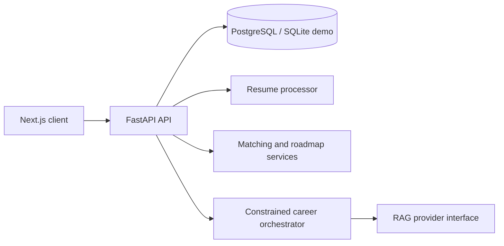

# Architecture

The Next.js client makes authenticated REST calls. FastAPI owns authorization, business logic and persistence. Demo mode uses deterministic local services; a provider boundary is reserved for LLM, embeddings, storage and job providers.
